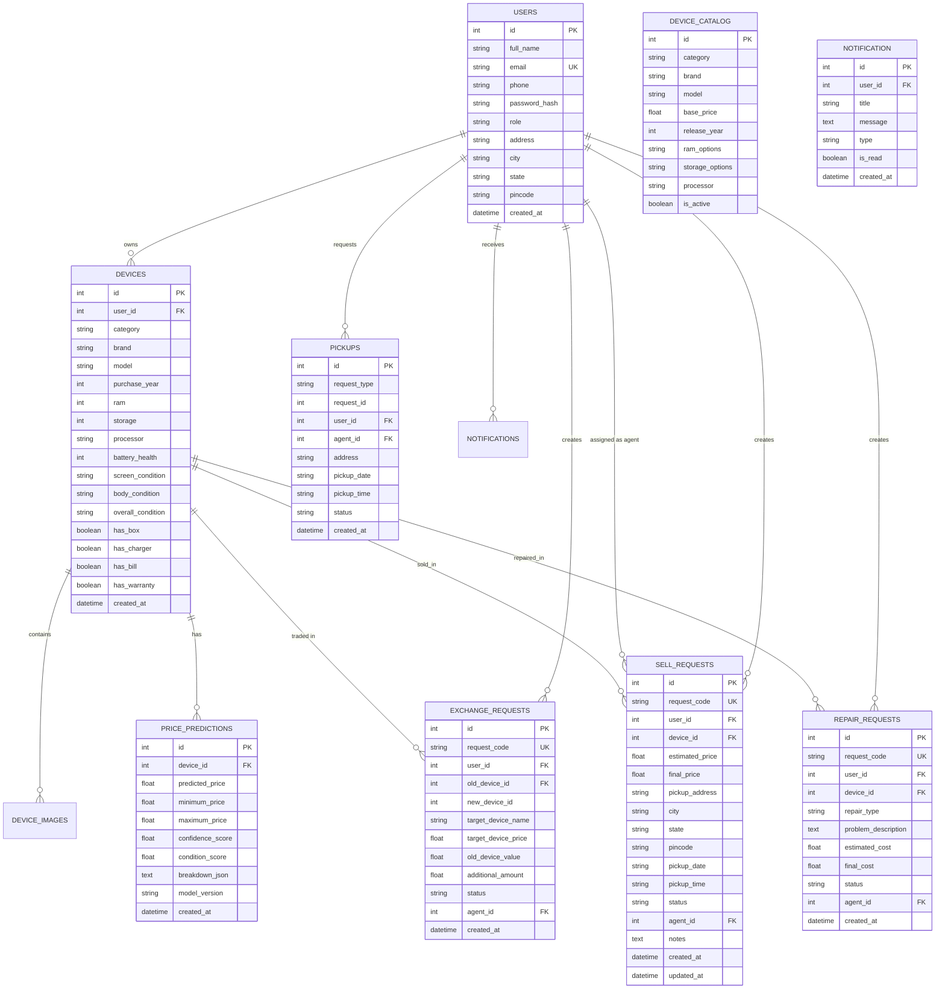

# RETECH AI — Database Architecture & Schema Specification
**RDBMS Compatibility:** SQLite 3 (Development) / MySQL 8.0+ (Production)  
**ORM:** SQLAlchemy with Flask-SQLAlchemy 3.1  

---

## 1. Entity Relationship (ER) Diagram

---

## 2. Table DDL Definitions & Column Constraints

### 2.1 `users`
Primary entity storing system participants across roles (`CUSTOMER`, `AGENT`, `ADMIN`).
| Column | Type | Nullable | Default | Description |
|---|---|---|---|---|
| `id` | INTEGER | No | PK Auto | Unique user identifier |
| `full_name` | VARCHAR(120) | No | - | Full legal name |
| `email` | VARCHAR(120) | No | UK Index | User email address |
| `phone` | VARCHAR(20) | Yes | NULL | Contact phone number |
| `password_hash` | VARCHAR(255) | No | - | Cryptographic hash (Werkzeug) |
| `role` | VARCHAR(20) | No | 'CUSTOMER' | RBAC role: CUSTOMER, AGENT, ADMIN |
| `address` | VARCHAR(255) | Yes | NULL | Street address |
| `city` | VARCHAR(100) | Yes | NULL | City |
| `state` | VARCHAR(100) | Yes | NULL | State/Province |
| `pincode` | VARCHAR(20) | Yes | NULL | Postal PIN code |
| `created_at` | DATETIME | No | UTC Now | Timestamp of registration |

### 2.2 `device_catalog`
Master reference table managing official market hardware models and retail prices.
| Column | Type | Nullable | Default | Description |
|---|---|---|---|---|
| `id` | INTEGER | No | PK Auto | Unique catalog reference |
| `category` | VARCHAR(50) | No | - | Smartphone, Laptop, Tablet, Smartwatch |
| `brand` | VARCHAR(100) | No | - | Manufacturer brand (Apple, Samsung, Dell) |
| `model` | VARCHAR(100) | No | - | Device model designation |
| `base_price` | FLOAT | No | - | Base retail price (INR) |
| `release_year` | INTEGER | No | - | Year of official market launch |
| `ram_options` | VARCHAR(100) | Yes | NULL | Comma-separated RAM tiers (e.g. '8,16') |
| `storage_options`| VARCHAR(100) | Yes | NULL | Comma-separated Storage tiers (e.g. '128,256') |
| `processor` | VARCHAR(100) | Yes | NULL | Chipset/Processor name |
| `is_active` | BOOLEAN | No | True | Availability flag |

### 2.3 `devices`
User registered devices submitted for resale, exchange, or valuation.
| Column | Type | Nullable | Default | Description |
|---|---|---|---|---|
| `id` | INTEGER | No | PK Auto | Unique device ID |
| `user_id` | INTEGER | No | FK users.id | Owner foreign key |
| `category` | VARCHAR(50) | No | - | Category designation |
| `brand` | VARCHAR(100) | No | - | Device brand |
| `model` | VARCHAR(100) | No | - | Device model name |
| `purchase_year` | INTEGER | No | - | Year original owner purchased |
| `ram` | INTEGER | Yes | NULL | RAM in GB |
| `storage` | INTEGER | Yes | NULL | Storage in GB |
| `battery_health` | INTEGER | Yes | 85 | Battery health percentage (0-100) |
| `screen_condition`| VARCHAR(50) | No | 'Good' | Excellent, Good, Fair, Poor |
| `body_condition` | VARCHAR(50) | No | 'Good' | Excellent, Good, Fair, Poor |
| `overall_condition`| VARCHAR(50)| No | 'Good' | Excellent, Good, Fair, Poor |
| `has_box` | BOOLEAN | No | False | Original box present |
| `has_charger` | BOOLEAN | No | False | Original adapter present |
| `has_bill` | BOOLEAN | No | False | Valid purchase invoice |
| `has_warranty` | BOOLEAN | No | False | Active brand warranty |
| `created_at` | DATETIME | No | UTC Now | Submission timestamp |

### 2.4 `price_predictions`
Evaluated resale values generated by the Machine Learning regression engine.
| Column | Type | Nullable | Default | Description |
|---|---|---|---|---|
| `id` | INTEGER | No | PK Auto | Prediction record ID |
| `device_id` | INTEGER | No | FK devices.id | Evaluated device |
| `predicted_price`| FLOAT | No | - | Estimated fair market price (INR) |
| `minimum_price` | FLOAT | No | - | Guaranteed lower bound |
| `maximum_price` | FLOAT | No | - | Potential upper bound |
| `confidence_score`| FLOAT | No | - | Confidence percentage (0-100%) |
| `condition_score`| FLOAT | No | - | Composite condition score (0-10) |
| `breakdown_json` | TEXT | Yes | NULL | Detailed itemized breakdown |
| `model_version` | VARCHAR(20) | No | '1.0' | Serialized ML model version |
| `created_at` | DATETIME | No | UTC Now | Prediction timestamp |

### 2.5 `sell_requests`
End-to-end sell orders with doorstep pickup and inspection workflow.
| Column | Type | Nullable | Default | Description |
|---|---|---|---|---|
| `id` | INTEGER | No | PK Auto | Sell request ID |
| `request_code` | VARCHAR(30) | No | UK Index | Formatted reference (e.g. SELL-2026-1001) |
| `user_id` | INTEGER | No | FK users.id | Customer ID |
| `device_id` | INTEGER | No | FK devices.id | Device ID |
| `estimated_price`| FLOAT | No | - | Initial AI predicted valuation |
| `final_price` | FLOAT | Yes | NULL | Price verified post physical check |
| `pickup_address`| VARCHAR(255)| No | - | Collection street address |
| `city` | VARCHAR(100)| No | - | City |
| `state` | VARCHAR(100)| No | - | State |
| `pincode` | VARCHAR(20) | No | - | Postal PIN code |
| `pickup_date` | VARCHAR(30) | No | - | Scheduled collection date |
| `pickup_time` | VARCHAR(30) | No | - | Time slot |
| `status` | VARCHAR(50) | No | 'Requested' | Requested, Confirmed, Agent Assigned, Pickup Scheduled, Picked Up, Inspection, Final Offer, Completed, Cancelled |
| `agent_id` | INTEGER | Yes | FK users.id | Assigned field executive |
| `notes` | TEXT | Yes | NULL | Diagnostic / customer notes |
| `created_at` | DATETIME | No | UTC Now | Creation timestamp |

---

## 3. Indexing Strategy
- `users(email)`: Unique B-tree index for $O(1)$ authentication lookups.
- `sell_requests(request_code)`: Unique index for instant tracking query resolution.
- `devices(user_id)`: Foreign key index for accelerated user dashboard portfolio queries.
- `price_predictions(device_id)`: Foreign key index for fast retrieval of latest valuations.
