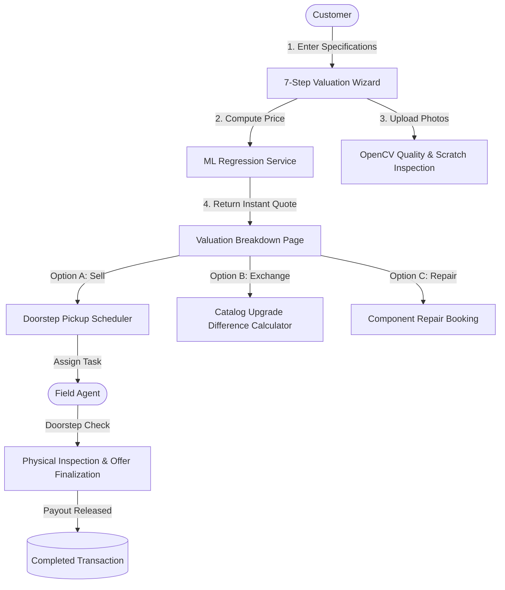

# Software Requirements Specification (SRS)
## Project: RETECH AI
### AI-Powered Smart Device Resale, Exchange & Repair Platform
*"Smart Value. Smarter Decisions."*

**Document Version:** 1.0.0  
**Status:** Approved  
**Author:** Senior Full-Stack & ML Architect  

---

## 1. Introduction

### 1.1 Purpose
This document specifies the software requirements for **RETECH AI**, an intelligent web application designed to automate, optimize, and secure the end-to-end lifecycle of pre-owned smart devices (smartphones, laptops, tablets, and smartwatches). It covers automated AI/ML-driven valuation, dynamic device exchange math, doorstep repair booking, field agent assignment, and administrative oversight.

### 1.2 Scope
RETECH AI bridges the gap between used-device owners, certified inspection technicians, and refurbishing businesses. It replaces subjective, arbitrary second-hand pricing tables with an ensemble Machine Learning regression pipeline (evaluated across Linear Regression, Random Forest, and Gradient Boosting) and integrates Computer Vision (OpenCV & Pillow) for physical surface analysis.

### 1.3 Definitions, Acronyms, and Abbreviations
- **SRS**: Software Requirements Specification
- **JWT**: JSON Web Token
- **RBAC**: Role-Based Access Control
- **MAE**: Mean Absolute Error
- **RMSE**: Root Mean Squared Error
- **R² Score**: Coefficient of Determination
- **CV**: Computer Vision
- **OEM**: Original Equipment Manufacturer

---

## 2. Overall Description

### 2.1 Product Perspective
RETECH AI operates as a distributed client-server architecture:
1. **Presentation Layer**: Responsive React 18 Single Page Application (SPA) powered by Vite, Tailwind CSS, Lucide icons, and Recharts.
2. **Application & Service Layer**: Python 3.12 Flask RESTful API with modular Blueprints, token-based authentication, and service-layer abstraction.
3. **Intelligence Layer**: Scikit-Learn regression pipelines serialized via Joblib, coupled with OpenCV image processing.
4. **Data Persistence Layer**: Relational database (SQLite in development, architecturally compliant with MySQL/PostgreSQL in production).

### 2.2 User Classes and Characteristics
1. **Customer**: Individuals looking to value, sell, exchange, or book doorstep repairs for used electronics.
2. **Field Agent**: Certified inspection technicians who visit customer premises, verify hardware condition against declared specs, adjust final offers, and release instant payouts.
3. **Platform Administrator**: System executives who monitor transaction volume, assign agents, manage user privileges, and maintain the central hardware catalog.

### 2.3 Operating Environment
- **Server**: Linux / Windows / macOS running Python 3.10+
- **Database**: SQLite 3 / MySQL 8.0+
- **Browser Compatibility**: Chrome (latest), Edge (latest), Firefox (latest), Safari (latest) across mobile, tablet, and desktop viewports (390px to 1920px).

---

## 3. System Architecture & Features

---

## 4. Functional Requirements

### 4.1 Authentication & Authorization Module (AUTH)
- **REQ-AUTH-01**: The system shall allow users to register with Full Name, Email, Phone, Password, Address, City, State, and Pincode.
- **REQ-AUTH-02**: Passwords shall be cryptographically hashed using Werkzeug (`scrypt` / `pbkdf2:sha256`) before database persistence. Plain text passwords shall never be logged or stored.
- **REQ-AUTH-03**: The system shall issue JSON Web Tokens (JWT) upon successful authentication, valid for 7 days.
- **REQ-AUTH-04**: Role-based access control (RBAC) decorators (`@admin_required`, `@agent_required`) shall protect administrative and technician endpoints. Customers attempting unauthorized access shall receive an HTTP 403 response.

### 4.2 Dynamic Catalog Management (CATALOG)
- **REQ-CAT-01**: Device categories (Smartphones, Laptops, Tablets, Smartwatches) and specifications shall be dynamically served from the database, eliminating hardcoded client-side catalogs.
- **REQ-CAT-02**: Platform administrators shall be able to create, edit, deactivate, and delete catalog items.

### 4.3 Intelligent Valuation & ML Pipeline (VALUATION)
- **REQ-VAL-01**: The system shall collect category, brand, model, purchase year, storage, RAM, battery health, cosmetic condition, and accessory checklist.
- **REQ-VAL-02**: The backend shall run a trained Scikit-learn regression model to predict resale price, minimum price, maximum price, confidence index, and condition score (0-10).
- **REQ-VAL-03**: The system shall return a transparent, itemized valuation breakdown detailing base market value, age depreciation, condition adjustment, battery penalty, accessories credit, and warranty bonus.

### 4.4 Computer Vision Condition Analysis (CV)
- **REQ-CV-01**: The system shall accept images (front, back, screen, damage) with extension validation (PNG, JPG, JPEG, WEBP) and file size cap (16MB).
- **REQ-CV-02**: The CV service shall compute Laplacian blur variance and Canny edge density to detect surface fractures or deep scratches, labeled transparently as *"AI-assisted image preprocessing / prototype condition analysis"*.

### 4.5 Resale Transaction Flow (SELL)
- **REQ-SELL-01**: Users can confirm a sell request by providing pickup address, preferred date, and preferred time window.
- **REQ-SELL-02**: A unique tracking code (e.g. `SELL-2026-XXXX`) and linked `Pickup` record shall be generated automatically.
- **REQ-SELL-03**: The request status shall follow the verified pipeline: `Requested` → `Confirmed` → `Agent Assigned` → `Pickup Scheduled` → `Picked Up` → `Inspection` → `Final Offer` → `Completed`.

### 4.6 Smart Device Exchange (EXCHANGE)
- **REQ-EXCH-01**: Users can choose any active catalog device as an upgrade target.
- **REQ-EXCH-02**: The system shall calculate the net payable difference: $\text{Additional Amount} = \max(0, \text{Target Retail Price} - \text{Assessed Trade-In Value})$.

### 4.7 Doorstep Repair Booking (REPAIR)
- **REQ-REP-01**: Users can book repairs across categories: Screen, Battery, Charging Port, Camera, Speaker, Software, and Other.
- **REQ-REP-02**: The system shall provide an instant estimated cost based on device category and component type, accompanied by a 6-month warranty badge.

### 4.8 Operations & Field Agent Inspection (AGENT)
- **REQ-AGENT-01**: Agents shall view a real-time queue of assigned pickups and pending inspections.
- **REQ-AGENT-02**: Agents shall be able to record verified physical condition, adjust final offer price with inspection notes, and complete transactions.

### 4.9 Admin Control Center & Telemetry (ADMIN)
- **REQ-ADMIN-01**: Admin dashboard shall display aggregate KPIs (Total Users, Devices, Valuations, Sell/Exchange/Repair volume, Gross Transaction Value).
- **REQ-ADMIN-02**: Interactive charts (Recharts) shall render monthly volume trends and hardware category distributions.
- **REQ-ADMIN-03**: Admins can assign field agents to pending sell, exchange, and repair bookings.

---

## 5. Non-Functional Requirements

### 5.1 Performance
- ML prediction execution latency shall be under 150 milliseconds.
- API response time for typical CRUD queries shall not exceed 300 milliseconds.

### 5.2 Security
- Input sanitation on all REST endpoints to prevent SQL injection and cross-site scripting (XSS).
- CORS headers configured to permit authorized origins.
- File uploads sanitized using `secure_filename` with random UUID hashing.

### 5.3 Reliability & Availability
- Graceful error responses with unified envelope format `{ success: bool, message: str, error: str }`.
- Zero application crash upon model missing: fallback heuristics ensure operational continuity.

---

## 6. Verification & Acceptance
All functional requirements are validated against automated unit and integration tests executing with `pytest` and end-to-end browser walkthroughs.
